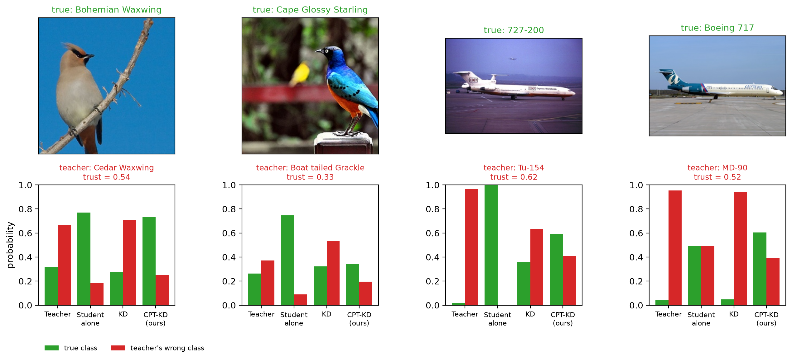

# CPT-KD: Class-Pair Trust Knowledge Distillation

**When the Student Is Right: Class-Pair Trust Knowledge Distillation for Fine-Grained Recognition**
Aniruddha Bohra (P25CS0201), Naveen Pratap (M26CSE017). CSL7620 Machine Learning, IIT Jodhpur.

- Repository: https://github.com/flex6699/cpt-kd
- Report (CVPR format): [`report/main.pdf`](report/main.pdf)
- Reproducibility declaration: [`REPRODUCIBILITY.md`](REPRODUCIBILITY.md)



Knowledge distillation (KD) makes a small student copy a big teacher's soft labels, **including the teacher's
confusions between look-alike classes**, even where the student would be right on its own (above: real test
images). CPT-KD estimates, from cross-fitted out-of-fold predictions, how much more the teacher confuses each
class pair `(y, c)` than a student trained alone:

```
trust(y, c) = min(1, (p_student_alone(c | y) + eps) / (p_teacher(c | y) + eps))
```

It then scales the teacher's soft label on low-trust pairs. The wrong classes are rescaled to their original
total, and the true-class probability is unchanged. The change is about 20 lines on top of KD
(`cls/losses.py: clean_with_trust`) and adds no new parameters.

## Main results (3 seeds, mean)

| Setup (ResNet-50 teacher) | Acc. KD → CPT-KD | Inheritance KD → CPT-KD | Flagged-pair inh. (alone / KD / CPT-KD) |
|---|---|---|---|
| CUB, ResNet-18 | 80.7 → 80.4 | 47.4 → 45.3 | 33.0 / 39.4 / **29.6** |
| CUB, MobileNetV2 | 81.7 → 81.2 | 47.5 → 45.9 | 32.5 / 37.1 / **31.0** |
| Aircraft, ResNet-18 | 82.8 → 82.7 | 36.6 → 35.0 | 21.2 / 22.4 / **18.6** |
| Aircraft, MobileNetV2 | 84.1 → 84.0 | 37.6 → 36.4 | 25.6 / 30.1 / **21.2** |

The full tables with all 9 methods are in `results/cls/table_*.md` and the report. The extension to medical
segmentation (ACDC, SAM ViT-L teacher) is in `seg/` and Sec. 6 of the report.

## Repository layout

```
cls/            fine-grained classification (CUB-200-2011, FGVC-Aircraft): the main experiments
  prepare_data.py     step 1: resize images, write meta.csv with splits and 5 folds
  fast_download.py    optional parallel downloader for the datasets
  oof_and_trust.py    step 2: 5-fold out-of-fold teachers/students, full teacher, trust tables
  losses.py           all 9 methods (CE, KD, DKD, WSL, KA, per-image gate, class trust, CPT-KD, CPT-KD+DKD)
  train_student.py    step 3: train + evaluate one student (all metrics)
  make_jobs.py, run_queue.py, jobs_*.txt   the exact job lists that were run, and a multi-GPU queue
  analyze.py, print_results.py             summary tables / figures (results/cls/)
  make_tables.py, make_figures.py          LaTeX tables and figures of the report
  quick_evidence.py, mahalanobis_check.py  preliminary poster experiment and a side analysis
seg/            extension: CPT-KD for medical segmentation (ACDC) on top of the IAD code base
  cpt_pilot.py          trust table on held-out slices + pixel-level inheritance metrics
  train_ACDC_clean.py   IAD training script with `--kd_loss cpt` (see cpt_kd_seg.patch for the exact change)
  make_seg_figure.py    qualitative figure; run_acdc.sh: all ACDC commands
environment/    conda environments (exported) and pip requirements
results/        every per-run results.json/args.json, logs, trust tables, summary tables and figures
checkpoints/    checkpoint manifest (sizes, SHA-256) and download / regeneration instructions
report/         LaTeX source (CVPR 2027 author kit) and the compiled report
slides/         presentation
```

## Reproducing the classification experiments

Hardware used: 1x RTX A6000 (48 GB) + 2x RTX A5000 (24 GB), CUDA 12.4 driver. One student run takes 5–11 min.

```bash
# 0) environment (either one)
conda env create -f environment/environment_teakd.yml && conda activate teakd
# or: python -m venv .venv && source .venv/bin/activate && \
#     pip install torch==2.5.1 torchvision==0.20.1 --index-url https://download.pytorch.org/whl/cu124 && \
#     pip install -r environment/requirements_teakd.txt
cd cls

# 1) data (NOT included in this repository, see "Datasets" below)
git clone https://github.com/cyizhuo/CUB-200-2011-dataset  data/raw/CUB-200-2011-dataset
git clone https://github.com/cyizhuo/FGVC_Aircraft_dataset  data/raw/FGVC_Aircraft_dataset
python prepare_data.py --dataset cub      --src data/raw/CUB-200-2011-dataset --out data/tea_kd/cub
python prepare_data.py --dataset aircraft --src data/raw/FGVC_Aircraft_dataset --out data/tea_kd/aircraft

# 2) out-of-fold predictions, full teacher, trust tables (about 1 h per dataset on 2 GPUs)
python oof_and_trust.py --data data/tea_kd/cub      --models teacher --gpu 0 &
python oof_and_trust.py --data data/tea_kd/cub      --models student --gpu 1 ; wait
python oof_and_trust.py --data data/tea_kd/aircraft --models teacher --gpu 0 &
python oof_and_trust.py --data data/tea_kd/aircraft --models student --gpu 1 ; wait

# 3) all students: 9 methods x 2 students x 3 seeds x 2 datasets (the exact list we ran)
python make_jobs.py --keep-target                      # writes jobs_full.txt
python run_queue.py jobs_full.txt --gpus 0 1 2 --per-gpu 2
python run_queue.py jobs_cub_variants.txt --gpus 0 1 2 --per-gpu 2   # ablations of Table 5

# 4) tables and figures
python analyze.py                                      # results/ summary + markdown tables
python print_results.py --dataset cub ; python print_results.py --dataset aircraft
cd .. && python cls/make_tables.py  --runs cls/runs --out report/tables
python cls/make_figures.py --runs cls/runs --data cls/data/tea_kd --out report/figs
```

To check our numbers without retraining, point `make_tables.py` at the released results:
`python cls/make_tables.py --runs results/cls/runs --out /tmp/tables` regenerates Tables 1–2 and 4–5 of the
report exactly. `make_figures.py` also needs the test logits (see `checkpoints/README.md`).

## Reproducing the segmentation extension (ACDC)

```bash
git clone https://github.com/hjklearn/IAD && cd IAD && git checkout ad6a191
cp ../seg/{cpt_pilot.py,make_seg_figure.py} . && cp ../seg/train_ACDC_clean.py ACDC_Tool/
conda env create -f ../environment/environment_iad.yml && conda activate iad
# ACDC data as in the EMCAD repository; SAM ViT-L weights: sam_vit_l_0b3195.pth (Meta, Apache-2.0)
bash ../seg/run_acdc.sh          # teacher, student, KD and CPT-KD runs + pilot + figure
```

## Datasets (not included)

| Dataset | Official source | Copy used | License / note |
|---|---|---|---|
| CUB-200-2011 | https://data.caltech.edu/records/65de6-vp158 | https://github.com/cyizhuo/CUB-200-2011-dataset | non-commercial research |
| FGVC-Aircraft (2013b) | https://www.robots.ox.ac.uk/~vgg/data/fgvc-aircraft/ | https://github.com/cyizhuo/FGVC_Aircraft_dataset | non-commercial research |
| ACDC | https://www.creatis.insa-lyon.fr/Challenge/acdc/ | preprocessed as in https://github.com/SLDGroup/EMCAD | registration required |

The datasets total about 4.5 GB and are hosted by their owners, so they are not redistributed here.

## Checkpoints

The weights are 45–96 MB per model, and the full set (including 66 + 54 student runs) is several GB, so they are
not stored in git. See [`checkpoints/README.md`](checkpoints/README.md) for sizes, SHA-256 hashes, the reason they are
not uploaded and how to regenerate each file.

## Acknowledgements

The segmentation extension builds on the official IAD code (https://github.com/hjklearn/IAD) and
Segment Anything (Meta AI). The CVPR template is from https://github.com/cvpr-org/author-kit.
